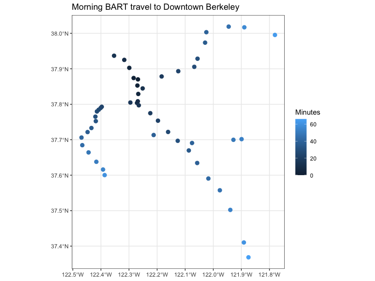
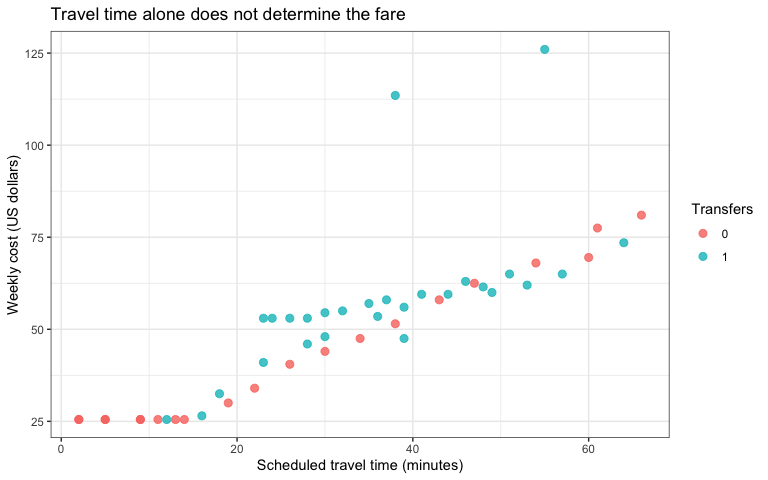

# bartcommute
Cathy Fang

<!--
Keep project.qmd beside the data folder included in the ZIP.
Rendering reads saved data; installing bartcommute is only needed in Part 4.
Run eval: false chunks at the console.
Keep the course template's .Rbuildignore and setup comment.
-->

## Part 1: Wrap the API

### Step 1: DESCRIPTION and LICENSE

`DESCRIPTION`

``` text
Package: bartcommute
Title: Compare BART Commutes to Downtown Berkeley
Version: 0.1.0
Authors@R: person("Cathy", "Fang", email = "28hfang@berkeley.edu",
    role = c("aut", "cre"))
Description: Request BART stations and scheduled trips, return tidy tables,
    and compare morning commutes to Downtown Berkeley. Includes a saved
    snapshot of scheduled travel times and adult Clipper fares.
License: MIT + file LICENSE
Encoding: UTF-8
Depends: R (>= 4.1.0)
LazyData: true
Roxygen: list(markdown = TRUE)
Imports:
    httr2,
    lubridate,
    tibble
Suggests:
    dplyr,
    ggplot2,
    knitr,
    sf,
    testthat (>= 3.0.0)
Config/testthat/edition: 3
Config/roxygen2/version: 8.1.1
```

`LICENSE`

``` text
YEAR: 2026
COPYRIGHT HOLDER: Cathy Fang
```

### Step 2: Dependencies

``` r
library(usethis)
use_package("httr2")
use_package("lubridate")
use_package("tibble")
use_package("dplyr", type = "Suggests")
use_package("ggplot2", type = "Suggests")
use_package("sf", type = "Suggests")
use_package("knitr", type = "Suggests")
```

Named imports (`@importFrom`) replace the assignment’s
namespace-qualified calls to follow the requested code style.

### Step 3: Inspect the requests and JSON

[Trip
request](https://api.bart.gov/api/sched.aspx?cmd=arrive&orig=MLBR&dest=DBRK&date=11/18/2026&time=8:45am&b=0&a=0&key=MW9S-E7SL-26DU-VV8V&json=y)

``` r
library(httr2)
res <- request("https://api.bart.gov/api/sched.aspx") |>
  req_url_query(cmd = "arrive", orig = "MLBR", dest = "DBRK",
                date = "11/18/2026", time = "8:45am", b = 0, a = 0,
                key = "MW9S-E7SL-26DU-VV8V", json = "y") |>
  req_perform()
body <- resp_body_json(res, simplifyVector = TRUE)
trip <- body$root$schedule$request$trip
trip

res_stations <- request("https://api.bart.gov/api/stn.aspx") |>
  req_url_query(cmd = "stns", key = "MW9S-E7SL-26DU-VV8V", json = "y") |>
  req_perform()
body_stations <- resp_body_json(res_stations, simplifyVector = TRUE)
body_stations$root$stations$station
```

The `@` names are XML attributes retained in the JSON response.

### Step 4: Identify the adult Clipper fare

``` r
trip$`@fare`
trip$`@clipper`
trip$fares$fare
```

The adult fare is the `@amount` in `fares$fare` with
`@class == "clipper"`: \$6.95, matching [BART’s fare
calculator](https://www.bart.gov/tickets/calculator). Here `@fare` is
also 6.95; `@clipper` is 2.60, the senior/disabled fare. Convert
coordinates, duration, and fare to numbers, and trip times to Pacific
date-times.

### Step 5: bart_stations()

``` r
library(usethis)
use_r("stations")
```

`R/stations.R`

``` r
#' Get BART stations
#'
#' Request station names, locations, and abbreviations from the BART API.
#'
#' @param key BART API key. Defaults to BART's shared public key.
#' @returns A tibble with one row per station and six columns: abbr, name,
#'   city, county, lat, and lon. Coordinates are numeric decimal degrees.
#' @examples
#' bart_stations()
#' @importFrom httr2 request req_url_query req_perform resp_body_json
#' @importFrom tibble tibble
#' @export
bart_stations <- function(key = "MW9S-E7SL-26DU-VV8V") {
  res <- request("https://api.bart.gov/api/stn.aspx") |>
    req_url_query(cmd = "stns", key = key, json = "y") |>
    req_perform()

  body <- resp_body_json(res, simplifyVector = TRUE)
  stations <- body$root$stations$station

  tibble(
    abbr = stations$abbr,
    name = stations$name,
    city = stations$city,
    county = stations$county,
    lat = as.numeric(stations$gtfs_latitude),
    lon = as.numeric(stations$gtfs_longitude)
  )
}
```

### Step 6: bart_trip()

``` r
use_r("trip")
```

`R/trip.R`

``` r
#' Get a scheduled BART trip
#'
#' Find the last trip that arrives by a deadline and its adult Clipper fare.
#' Times use the America/Los_Angeles time zone.
#' When two valid station codes are identical, return a zero-minute,
#' zero-fare row at the deadline. This means no train journey and no entry
#' through a fare gate, rather than an actual same-station excursion fare.
#'
#' @param orig One nonmissing origin station abbreviation, as a string.
#' @param dest One nonmissing destination station abbreviation, as a string.
#'   Defaults to Downtown Berkeley, DBRK.
#' @param arrive_by Arrival deadline, such as "8:45am".
#' @param date Trip date in month/day/year format. Defaults to 11/18/2026.
#' @param key BART API key. Defaults to BART's shared public key.
#' @returns A one-row tibble with orig, dest, depart, arrive, minutes, fare,
#'   and transfers. Depart and arrive are Pacific date-times, minutes is
#'   numeric, fare is the adult one-way Clipper fare in US dollars, and
#'   transfers is the number of train changes.
#' @examples
#' bart_trip("MLBR")
#' @importFrom httr2 request req_url_query req_perform resp_body_json
#' @importFrom lubridate mdy_hm
#' @importFrom tibble tibble
#' @export
bart_trip <- function(orig, dest = "DBRK", arrive_by = "8:45am",
                      date = "11/18/2026", key = "MW9S-E7SL-26DU-VV8V") {
  if (!is.character(orig) || length(orig) != 1 || any(is.na(orig)) || orig == "") {
    stop("orig must be a single nonmissing station string")
  }
  if (!is.character(dest) || length(dest) != 1 || any(is.na(dest)) || dest == "") {
    stop("dest must be a single nonmissing station string")
  }

  # BART refuses a schedule request whose origin equals its destination.
  if (orig == dest) {
    stations <- bart_stations(key)
    if (!(orig %in% stations$abbr)) {
      stop("Unknown station abbreviation")
    }
    deadline <- mdy_hm(paste(date, arrive_by), tz = "America/Los_Angeles")
    return(tibble(
      orig = orig, dest = dest, depart = deadline, arrive = deadline,
      minutes = 0, fare = 0, transfers = 0
    ))
  }

  res <- request("https://api.bart.gov/api/sched.aspx") |>
    req_url_query(
      cmd = "arrive", orig = orig, dest = dest, date = date,
      time = arrive_by, b = 0, a = 0, key = key, json = "y"
    ) |>
    req_perform()

  body <- resp_body_json(res, simplifyVector = TRUE)
  trip <- body$root$schedule$request$trip
  if (is.null(trip)) {
    stop("BART returned no matching trip")
  }

  # These are XML attribute names retained in the JSON response.
  fares <- trip$fares$fare
  adult_fare <- fares[fares$`@class` == "clipper", ]
  if (nrow(adult_fare) != 1) {
    stop("BART returned no unique adult Clipper fare")
  }

  tibble(
    orig = orig,
    dest = dest,
    depart = mdy_hm(
      paste(trip$`@origTimeDate`, trip$`@origTimeMin`),
      tz = "America/Los_Angeles"
    ),
    arrive = mdy_hm(
      paste(trip$`@destTimeDate`, trip$`@destTimeMin`),
      tz = "America/Los_Angeles"
    ),
    minutes = as.numeric(trip$`@tripTime`),
    fare = as.numeric(adult_fare$`@amount`),
    transfers = nrow(trip$leg) - 1
  )
}
```

### Step 7: Document, load, and check

``` r
library(devtools)
document()
load_all()
bart_stations()
bart_trip("MLBR")
?bart_stations
?bart_trip
check(manual = FALSE)
```

## Part 2: Test It

### Step 1: Set up tests

``` r
library(usethis)
use_testthat()
use_test("stations")
use_test("trip")
```

`tests/testthat.R`

``` r
library(testthat)
library(bartcommute)

test_check("bartcommute")
```

### Step 2: Typical input, shape and types

`tests/testthat/test-stations.R`

``` r
test_that("stations have the documented columns and types", {
  stations <- bart_stations()
  expect_equal(names(stations), c("abbr", "name", "city", "county", "lat", "lon"))
  expect_true(nrow(stations) > 0)
  expect_type(stations$abbr, "character")
  expect_type(stations$name, "character")
  expect_type(stations$city, "character")
  expect_type(stations$county, "character")
  expect_type(stations$lat, "double")
  expect_type(stations$lon, "double")
})
```

`tests/testthat/test-trip.R`

``` r
library(lubridate)

test_that("a trip has the documented columns and types", {
  trip <- bart_trip("MLBR")
  expect_equal(nrow(trip), 1)
  expect_equal(names(trip), c("orig", "dest", "depart", "arrive",
                            "minutes", "fare", "transfers"))
  expect_type(trip$orig, "character")
  expect_type(trip$dest, "character")
  expect_true(inherits(trip$depart, "POSIXct"))
  expect_true(inherits(trip$arrive, "POSIXct"))
  expect_equal(attr(trip$depart, "tzone"), "America/Los_Angeles")
  expect_equal(attr(trip$arrive, "tzone"), "America/Los_Angeles")
  expect_type(trip$minutes, "double")
  expect_type(trip$fare, "double")
  expect_true(is.numeric(trip$transfers))
})
```

### Step 3: Typical input, rules

`tests/testthat/test-stations.R`

``` r
test_that("station abbreviations are unique and coordinates are valid", {
  stations <- bart_stations()
  expect_equal(length(unique(stations$abbr)), nrow(stations))
  expect_true(all(!is.na(stations$lat)))
  expect_true(all(!is.na(stations$lon)))
  expect_true(all(stations$lat >= -90 & stations$lat <= 90))
  expect_true(all(stations$lon >= -180 & stations$lon <= 180))
})
```

`tests/testthat/test-trip.R`

``` r
test_that("a trip arrives by the deadline and obeys duration and fare rules", {
  trip <- bart_trip("MLBR")
  deadline <- mdy_hm("11/18/2026 8:45 AM", tz = "America/Los_Angeles")
  expect_true(all(trip$arrive <= deadline))
  expect_equal(trip$minutes,
               as.numeric(difftime(trip$arrive, trip$depart, units = "mins")))
  expect_true(all(trip$minutes > 0))
  expect_true(all(trip$fare > 0))
  expect_true(all(trip$transfers >= 0))
})
```

### Step 4: Edge cases

`tests/testthat/test-trip.R`

``` r
test_that("Millbrae needs no transfer and Dublin needs a transfer", {
  expect_equal(bart_trip("MLBR")$transfers, 0)
  expect_true(bart_trip("DUBL")$transfers >= 1)
})
```

### Step 5: Errors

`tests/testthat/test-trip.R`

``` r
test_that("bad origins produce useful errors", {
  expect_error(bart_trip(c("MLBR", "DUBL")), "single nonmissing station string")
  expect_error(bart_trip(123), "single nonmissing station string")
  expect_error(bart_trip(NA_character_), "single nonmissing station string")
  expect_error(bart_trip(character(0)), "single nonmissing station string")
  expect_error(bart_trip(""), "single nonmissing station string")
  expect_error(bart_trip("XXXX"), "400|no matching trip")
})

test_that("bad destinations produce useful errors", {
  expect_error(bart_trip("MLBR", dest = c("DBRK", "DUBL")), "dest must be")
  expect_error(bart_trip("MLBR", dest = NA_character_), "dest must be")
})
```

### Step 6: Downtown Berkeley bug

`tests/testthat/test-trip.R`

``` r
test_that("origin equal to destination means no train journey", {
  trip <- bart_trip("DBRK")
  deadline <- mdy_hm("11/18/2026 8:45 AM", tz = "America/Los_Angeles")
  expect_equal(nrow(trip), 1)
  expect_equal(trip$orig, "DBRK")
  expect_equal(trip$dest, "DBRK")
  expect_equal(trip$depart, deadline)
  expect_equal(trip$arrive, deadline)
  expect_equal(trip$minutes, 0)
  expect_equal(trip$fare, 0)
  expect_equal(trip$transfers, 0)
})

test_that("an unknown same-station code still gives an error", {
  expect_error(bart_trip("XXXX", dest = "XXXX"), "Unknown station abbreviation")
})
```

Before the fix, the DBRK test failed with HTTP 400. The same-station
branch in Part 1, Step 6 returns a zero-minute, zero-fare trip at the
deadline for a valid station. This represents no train journey.

### Step 7: Run tests and check

``` r
library(devtools)
test()
check(manual = FALSE)
```

``` text
[ FAIL 0 | WARN 0 | SKIP 0 | PASS 48 ]
0 errors | 0 warnings | 1 note
```

## Part 3: Store and Answer

### Step 1: Build and save commutes

``` r
library(usethis)
use_data_raw("commutes")
```

`data-raw/commutes.R`

``` r
# Run this script once from the package root to collect a new snapshot.
# This script calls the API; rendering project.qmd does not.
library(devtools)
library(usethis)
library(dplyr)

load_all()
stations <- bart_stations()
trips <- lapply(stations$abbr, bart_trip) |>
  bind_rows()

commutes <- stations |>
  left_join(trips, by = c("abbr" = "orig")) |>
  mutate(weekly_cost = 2 * 5 * fare)

use_data(commutes, overwrite = TRUE)
file.size("data/commutes.rda") / 1e6
```

``` r
source("data-raw/commutes.R")
```

The saved snapshot has 50 rows from 51 API requests and is 0.002865 MB.

### Step 2: Document commutes

`R/data.R`

``` r
#' Morning BART commutes to Downtown Berkeley
#'
#' A snapshot for arrival by 8:45 am on November 18, 2026. The Downtown
#' Berkeley row means no train journey and is constructed by bart_trip().
#' Other rows come from BART's scheduled trips, rather than observed rides.
#'
#' @format A tibble with 50 rows and 13 columns:
#' \describe{
#'   \item{abbr}{Origin station abbreviation.}
#'   \item{name}{Origin station name.}
#'   \item{city}{Origin station city.}
#'   \item{county}{County label as returned by BART.}
#'   \item{lat}{Latitude in decimal degrees, WGS 84.}
#'   \item{lon}{Longitude in decimal degrees, WGS 84.}
#'   \item{dest}{Destination station abbreviation, DBRK.}
#'   \item{depart}{Scheduled departure date-time in America/Los_Angeles.}
#'   \item{arrive}{Scheduled arrival date-time in America/Los_Angeles.}
#'   \item{minutes}{Scheduled station-to-station travel time in minutes.}
#'   \item{fare}{One-way adult Clipper fare in US dollars.}
#'   \item{transfers}{Number of train changes.}
#'   \item{weekly_cost}{Ten one-way adult Clipper fares in US dollars.}
#' }
#' @source BART Legacy API, retrieved November 18, 2026, for travel on
#'   November 18, 2026. Station list: https://api.bart.gov/api/stn.aspx .
#'   Scheduled trips: https://api.bart.gov/api/sched.aspx .
"commutes"
```

``` r
library(devtools)
document()
load_all()
?commutes
```

### Step 3: Map and stations within 30 minutes

``` r
commutes_sf <- commutes |>
  st_as_sf(coords = c("lon", "lat"), crs = 4326)

ggplot(commutes_sf) +
  geom_sf(aes(color = minutes), size = 2.5) +
  labs(title = "Morning BART travel to Downtown Berkeley", color = "Minutes") +
  theme_bw()
```

<div id="fig-commute-map">



Figure 1: Travel time to DBRK for arrival by 8:45 am on November 18,
2026. DBRK’s zero-minute row represents no train journey.

</div>

``` r
under_30 <- commutes |>
  filter(minutes <= 30) |>
  select(name, minutes, fare, transfers, weekly_cost) |>
  arrange(minutes, name)

kable(under_30, digits = 2)
```

| name                              | minutes | fare | transfers | weekly_cost |
|:----------------------------------|--------:|-----:|----------:|------------:|
| Downtown Berkeley                 |       0 | 0.00 |         0 |         0.0 |
| Ashby                             |       2 | 2.55 |         0 |        25.5 |
| North Berkeley                    |       2 | 2.55 |         0 |        25.5 |
| El Cerrito Plaza                  |       5 | 2.55 |         0 |        25.5 |
| MacArthur                         |       5 | 2.55 |         0 |        25.5 |
| 19th St./Oakland                  |       9 | 2.55 |         0 |        25.5 |
| El Cerrito del Norte              |       9 | 2.55 |         0 |        25.5 |
| 12th St./Oakland City Center      |      11 | 2.55 |         0 |        25.5 |
| Rockridge                         |      12 | 2.55 |         1 |        25.5 |
| Richmond                          |      13 | 2.55 |         0 |        25.5 |
| Lake Merritt                      |      14 | 2.55 |         0 |        25.5 |
| West Oakland                      |      16 | 2.65 |         1 |        26.5 |
| Orinda                            |      18 | 3.25 |         1 |        32.5 |
| Fruitvale                         |      19 | 3.00 |         0 |        30.0 |
| Coliseum                          |      22 | 3.40 |         0 |        34.0 |
| Embarcadero                       |      23 | 5.30 |         1 |        53.0 |
| Lafayette                         |      23 | 4.10 |         1 |        41.0 |
| Montgomery St.                    |      24 | 5.30 |         1 |        53.0 |
| Powell St.                        |      26 | 5.30 |         1 |        53.0 |
| San Leandro                       |      26 | 4.05 |         0 |        40.5 |
| Civic Center/UN Plaza             |      28 | 5.30 |         1 |        53.0 |
| Walnut Creek                      |      28 | 4.60 |         1 |        46.0 |
| 16th St./Mission                  |      30 | 5.45 |         1 |        54.5 |
| Bay Fair                          |      30 | 4.40 |         0 |        44.0 |
| Pleasant Hill/Contra Costa Centre |      30 | 4.80 |         1 |        48.0 |

### Step 4: Weekly cost and stations that break the pattern

``` r
travel <- commutes |>
  filter(abbr != "DBRK") |>
  mutate(weekly_cost = 2 * 5 * fare)

ggplot(travel, aes(x = minutes, y = weekly_cost, color = factor(transfers))) +
  geom_point(size = 2.5, alpha = 0.8) +
  labs(title = "Travel time alone does not determine the fare",
       x = "Scheduled travel time (minutes)",
       y = "Weekly cost (US dollars)", color = "Transfers") +
  theme_bw()
```

<div id="fig-time-cost">



Figure 2: Weekly cost for ten adult Clipper rides versus travel time,
colored by transfers. The no-train DBRK row is excluded.

</div>

``` r
airport_comparison <- travel |>
  filter(abbr %in% c("OAKL", "SFIA", "MLBR")) |>
  select(abbr, name, minutes, fare, transfers, weekly_cost) |>
  arrange(minutes)

kable(airport_comparison, digits = 2)
```

| abbr | name | minutes | fare | transfers | weekly_cost |
|:---|:---|---:|---:|---:|---:|
| OAKL | Oakland International Airport (OAK) | 38 | 11.35 | 1 | 113.5 |
| SFIA | San Francisco International Airport (SFO) | 55 | 12.60 | 1 | 126.0 |
| MLBR | Millbrae | 60 | 6.95 | 0 | 69.5 |

OAKL and SFIA cost more than the longer trip from Millbrae. BART’s
[distance-based fares](https://www.bart.gov/tickets) and [airport
premiums (Table
5)](https://www.bart.gov/sites/default/files/2024-12/1.%20BART%20Annual%20Comprehensive%20Financial%20Report%20%28002%29.pdf#page=137)
explain these expensive outliers.

### Step 5: Answer and limitation

Based on <a href="#fig-commute-map" class="quarto-xref">Figure 1</a>,
<a href="#fig-time-cost" class="quarto-xref">Figure 2</a>, and the
30-minute table, I would choose Ashby, North Berkeley, or MacArthur. The
first two have two-minute rides; MacArthur has a five-minute ride. All
three require no transfers and cost \$2.55 one way, or \$25.50 for ten
weekly rides. A limitation is that these are scheduled
station-to-station trips for one weekday: delays and walking time are
excluded, so reaching DBRK by 8:45 does not guarantee reaching every
classroom by 9:00.

## Part 4: Ship It

### Step 1: Check the package

``` r
library(devtools)
check(manual = FALSE)
```

``` text
0 errors | 0 warnings | 1 note
checking for future file timestamps ... NOTE
unable to verify current time
```

The note reflects a failed clock-verification request. `manual = FALSE`
omits PDF manual generation.

### Step 2: Install and try the package

``` r
library(devtools)
install()
```

Restart R.

``` r
library(bartcommute)
bart_trip("MLBR")
head(commutes)
?commutes
```

### Step 3: Commit and push

``` bash
git add .
git commit -m "Complete BART commute package"
git push
```

## Part 5: Write the README

### A. Overview

`bartcommute` wraps the [BART
API](https://api.bart.gov/docs/overview/index.aspx) to compare station
locations, scheduled travel times, fares, and transfers. Which stations
could I live near for a 9:00 am class, and what would five round trips
per week cost?

### B. Installation

``` r
library(remotes)
install_github("YOUR_GITHUB_USERNAME/YOUR_REPOSITORY")
```

Both functions default to BART’s public key.

### C. Usage

``` r
library(bartcommute)
bart_stations()
```

Recorded output: 50 rows; first six shown.

``` r
commutes |>
  select(abbr, name, city, county, lat, lon) |>
  head() |>
  kable(digits = 6)
```

| abbr | name | city | county | lat | lon |
|:---|:---|:---|:---|---:|---:|
| 12TH | 12th St./Oakland City Center | Oakland | alameda | 37.80377 | -122.2715 |
| 16TH | 16th St./Mission | San Francisco | sanfrancisco | 37.76506 | -122.4197 |
| 19TH | 19th St./Oakland | Oakland | alameda | 37.80835 | -122.2686 |
| 24TH | 24th St./Mission | San Francisco | sanfrancisco | 37.75247 | -122.4181 |
| ANTC | Antioch | Antioch | Contra Costa | 37.99539 | -121.7804 |
| ASHB | Ashby | Berkeley | alameda | 37.85280 | -122.2701 |

``` r
bart_trip("MLBR")
```

| orig | dest | depart (Pacific) | arrive (Pacific) | minutes | fare | transfers |
|:-----|:-----|:-----------------|:-----------------|--------:|-----:|----------:|
| MLBR | DBRK | 2026-11-18 07:31 | 2026-11-18 08:31 |      60 | 6.95 |         0 |

``` r
head(commutes)
```

    # A tibble: 6 x 13
      abbr  name                  city  county   lat   lon dest  depart             
      <chr> <chr>                 <chr> <chr>  <dbl> <dbl> <chr> <dttm>             
    1 12TH  12th St./Oakland Cit~ Oakl~ alame~  37.8 -122. DBRK  2026-11-18 08:32:00
    2 16TH  16th St./Mission      San ~ sanfr~  37.8 -122. DBRK  2026-11-18 08:13:00
    3 19TH  19th St./Oakland      Oakl~ alame~  37.8 -122. DBRK  2026-11-18 08:34:00
    4 24TH  24th St./Mission      San ~ sanfr~  37.8 -122. DBRK  2026-11-18 08:11:00
    5 ANTC  Antioch               Anti~ Contr~  38.0 -122. DBRK  2026-11-18 07:27:00
    6 ASHB  Ashby                 Berk~ alame~  37.9 -122. DBRK  2026-11-18 08:41:00
    # i 5 more variables: arrive <dttm>, minutes <dbl>, fare <dbl>,
    #   transfers <dbl>, weekly_cost <dbl>

### D. Analysis

See Part 3: [map and table](#step-3-map-and-stations-within-30-minutes),
[time-cost plot and
outliers](#step-4-weekly-cost-and-stations-that-break-the-pattern), and
[answer and limitation](#step-5-answer-and-limitation).

### E. Testing

**Typical inputs**

- Test that stations have the documented columns and types.
- Test that station abbreviations are unique and coordinates are valid.
- Test that a trip has the documented columns and types.
- Test that a trip arrives by the deadline and obeys duration and fare
  rules.

**Edge cases**

- Test that Millbrae needs no transfer and Dublin needs a transfer.
- Test that origin equal to destination means no train journey.

**Errors**

- Test that bad origins produce useful errors.
- Test that bad destinations produce useful errors.
- Test that an unknown same-station code still gives an error.

Bug test and fix: Part 2, Step 6. Results: Part 2, Step 7 and Part 4,
Step 1.

### Step 1: Render project.qmd

``` bash
quarto render project.qmd
```

### Step 2: Render without internet

Offline rendering passed using saved package data.

### Step 3: Push and review

Replace the GitHub repository placeholder, push, and review `README.md`
on GitHub.
